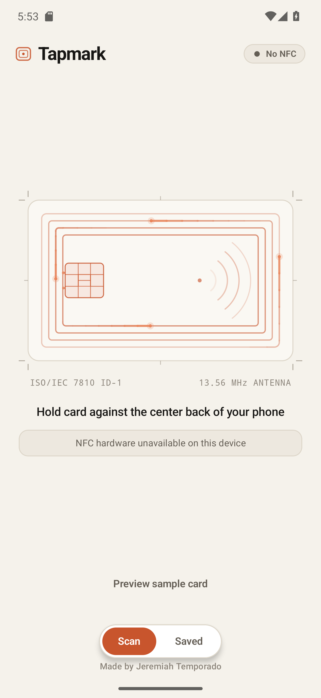
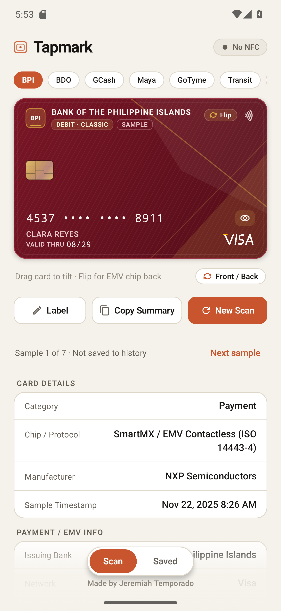
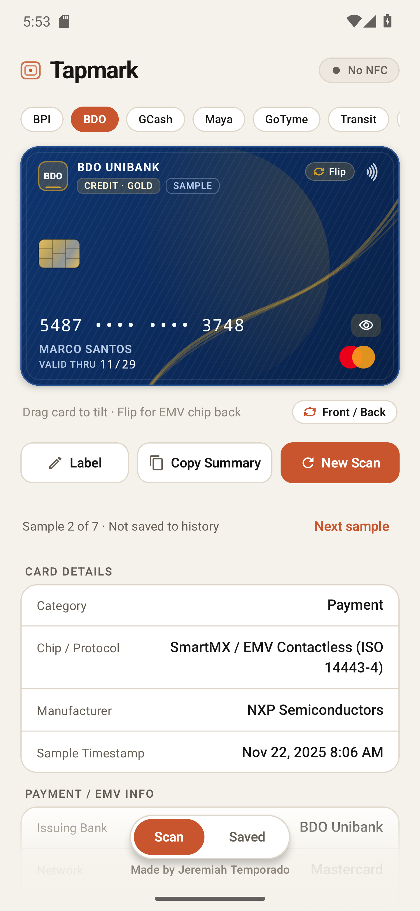
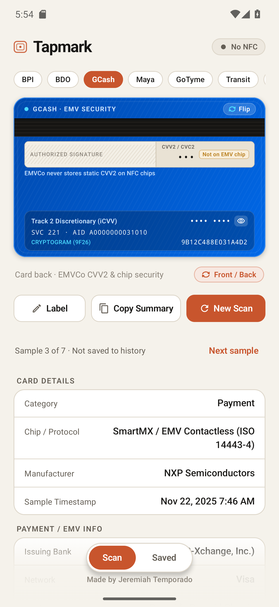
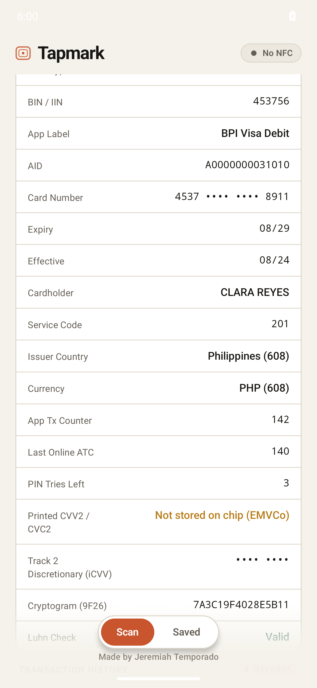
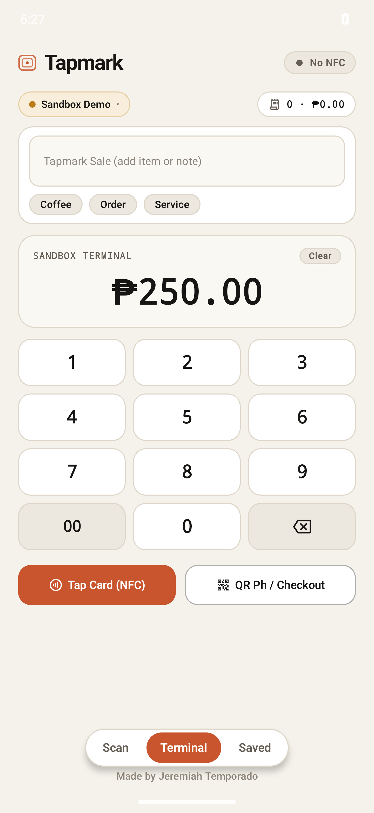
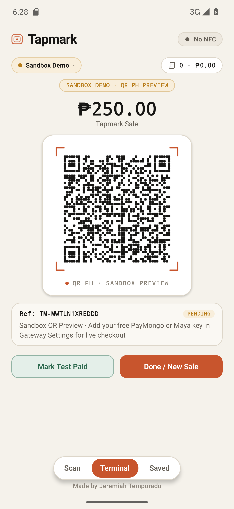

# Tapmark

**Tapmark** (`com.tapmark.nfc`) is an Android NFC card inspector and Hybrid Payment Terminal (`v1.4`) built with Kotlin and Jetpack Compose in a tactile archival paper and copper-coil design.

---

## App Preview

<table>
  <tr>
    <td align="center"><br /><sub><b>Copper Coil Scanner</b></sub></td>
    <td align="center"><br /><sub><b>BPI Card Artwork &amp; EMV</b></sub></td>
    <td align="center"><br /><sub><b>BDO Mastercard Artwork</b></sub></td>
  </tr>
  <tr>
    <td align="center"><br /><sub><b>3D Card Back &amp; Chip Security</b></sub></td>
    <td align="center"><br /><sub><b>EMV Ledger &amp; Chip Security</b></sub></td>
    <td align="center"><br /><sub><b>Hybrid Payment Terminal</b></sub></td>
  </tr>
  <tr>
    <td align="center"><br /><sub><b>QR Ph / Checkout Session</b></sub></td>
    <td align="center" colspan="2"><sub><b>Tapmark v1.4 Highlights</b><br />Animated Opening Intro &bull; 3D Touch-Tilt &amp; Flip<br />PayMongo / Maya QR Ph Checkout &bull; NFC Tap-to-Pay Sandbox Demo<br />EMV Chip Logs &bull; 34 Bank Card Artwork Themes<br /><br /><i>Made by Jeremiah Temporado</i></sub></td>
  </tr>
</table>

---

## Hybrid Payment Terminal (PayMongo / Maya QR Ph &amp; NFC Sandbox)

- **&#8369;0/month Online Gateway Integration:** Built-in support for **PayMongo Checkout Sessions** (`POST https://api.paymongo.com/v1/checkout_sessions` for `qrph`, `gcash`, `paymaya`, and `card`, plus live status polling), **Maya Checkout** (`pg-sandbox.paymaya.com` and `pg.paymaya.com`), and an optional **Custom Backend Proxy** URL &mdash; configurable in **Gateway Settings** with no monthly subscription fees. Hosted checkout redirects return cleanly to Tapmark via the `tapmark://payment/{success|cancel|failed}` deep link, and credentials stay in app-private `SharedPreferences` (`tapmark_gateway_prefs`).
- **QR Ph / Checkout &amp; Offline Sandbox Preview:** Renders crisp ZXing QR codes (`com.google.zxing:core:3.5.3`) from live checkout URLs or runs immediately offline in **Sandbox Demo** QR preview mode (`Mark Test Paid`).
- **NFC Tap-to-Pay Sandbox Demo &amp; Sales Ledger:** While the **Terminal** tab is awaiting a tap, `NfcAdapter.enableReaderMode` captures real contactless EMV cards directly into an animated `APPROVED` perforated digital receipt (alongside a built-in **Simulate BPI Tap** helper). Receipts and today's PHP (`&#8369;`) total persist locally in `tapmark_receipts.json`.
- **PCI MPoC Compliance Note:** Real live NFC contactless card charging (SoftPOS) requires PCI MPoC certification and acquiring bank merchant onboarding. For full transparency and compliance, Tapmark's NFC Tap-to-Pay flow operates as a **Sandbox Demo (No Real Charge)**, while real &#8369;0/month live payments use PayMongo or Maya QR Ph &amp; Hosted Checkout.

---

## Supported Bank Card Artwork

Custom geometric vector card artwork, brand palettes, crests, and vector network logos (`Visa`, `Mastercard`, `Amex`, `JCB`, `UnionPay`, `Discover`) are rendered for detected issuers:

- **Philippine Banks &amp; E-Wallets (19):** BPI, BDO Unibank, Metrobank, UnionBank, LandBank, GCash, Maya, GoTyme Bank, SeaBank / MariBank, RCBC, Security Bank, China Bank, PNB, EastWest Bank, CIMB Bank PH, Tonik, PSBank, Robinsons Bank, Asia United Bank (AUB).
- **Global Banks (15):** Chase, Bank of America, Wells Fargo, Citibank, Capital One, HSBC, Barclays, Revolut, Wise, Monzo, DBS, OCBC, UOB, American Express, Discover.

---

## EMV CVV2 / CVC2 Security Note

By global **EMVCo contactless security standards**, the static 3- or 4-digit **CVV2 / CVC2** printed on the back of a physical payment card is **never stored on the EMV chip** and cannot be read over NFC by any app.

Instead, Tapmark transparently reports that EMVCo protection on the flippable **3D Card Back** and in the **Payment / EMV Info** ledger while extracting the real chip-level cryptographic security fields when exposed by the card:
- **Dynamic CVC3** (`9F61` Track 2 / `9F60` Track 1)
- **Track 2 Discretionary Data (`iCVV` / `dCVV`)** from tag `57` (and Track 1 `9F1F`)
- **Application Cryptogram (`9F26`)** and **Service Code (`5F30`)**

Sensitive values (`panFull` and `chipCvcData`) are masked by default in the UI and stripped before writing local history.

---

## Features

- **Contactless EMV Payment Inspection**
  - Implements `SELECT 2PAY.SYS.DDF01` (PPSE) with priority sorting and fallback AIDs, `SELECT AID`, dynamic PDOL construction, `GET PROCESSING OPTIONS` (with non-zero amount & TTQ retry fallbacks), `READ RECORD` over AFL and fallback SFIs, and `GET DATA` (`9F36` ATC, `9F13` Last Online ATC, `9F17` PIN Try Counter, `9F4D`/`DF4D` & `9F4F`/`DF4F`).
  - Parses Track 2 (`57`), PAN (`5A`), masked PAN with 1-tap reveal toggle, expiry/effective dates, Luhn check, cardholder name, and network detection.
- **Issuing Bank Detection (Privacy-Safe)**
  - Resolves issuer bank, card type, tier, and country using a curated offline BIN database (`BankBinDatabase`), bundled compressed asset lookup (`app/src/main/assets/bin_db.tsv.gz`), EMV `5F50` Issuer URL & `50`/`9F12` application label matching, and optional live 6-digit-BIN-only lookup (`BankResolver`, strictly never transmitting more than 6 PAN digits).
- **EMV Chip Transaction History**
  - Discovers chip log records via `9F4D`/`DF4D` or common SFI probing, unwraps `0x70`-wrapped cyclic log records, skips uninitialized slots, validates `9A` dates and `9F21` timestamps, decodes 6-byte BCD and 4-byte binary amounts (`9F02`/`9F03`) with currency symbols, transaction type (`9C`), merchant (`9F4E`), per-log ATC (`9F36`), and cryptogram status (`9F27`).
- **NDEF & MIFARE / Tag Inspection**
  - Safe, read-only inspection via `NfcAdapter.enableReaderMode` across `IsoDep`, `Ndef`, `NfcA`, `NfcB`, `NfcF`, `NfcV`, `MifareClassic`, and `MifareUltralight` / NTAG chips.
  - Decodes Well-Known Text (UTF-8/UTF-16), URI prefixes, Wi-Fi `application/vnd.wfa.wsc` credentials, vCard, JSON, and memory/UID hex dumps (`UID`, reversed UID, decimal UID, ATQA/SAK, historical bytes).
- **Kinetic Copper Coil & 3D Card UI**
  - Warm archival paper (`#F5F2EB`) and copper terracotta (`#C8552D`) aesthetic with an animated launch emblem (`OpeningIntroOverlay`), kinetic `CopperCoilCanvas` with traveling loop pulses and tap-to-ping ripples, interactive 3D touch-tilt `PhysicalCardView`, expandable specification ledger, and local scan history (`CardHistoryRepository`, stripping full PANs before disk persistence).

---

## Requirements

- **JDK**: JDK 17+ (project compiles with Java 17 target; tested with Android Studio JBR / OpenJDK)
- **Android SDK**: `compileSdk = 37`, `minSdk = 26`, `targetSdk = 35`
- **Gradle**: Wrapper included (`./gradlew` / `gradlew.bat`, Gradle 9.9.2, AGP 9.5.2)

---

## Build & Test

Set `JAVA_HOME` and `ANDROID_HOME` (or configure `sdk.dir` in `local.properties`):

```bash
export JAVA_HOME="/path/to/jdk-or-jbr"
export ANDROID_HOME="/path/to/Android/Sdk"

# Run JVM unit tests
./gradlew :app:testDebugUnitTest

# Build release APK
./gradlew :app:assembleRelease
```

On Windows PowerShell:

```powershell
$env:JAVA_HOME = "D:\Android Studio\jbr"
$env:ANDROID_HOME = "$env:LOCALAPPDATA\Android\Sdk"

.\gradlew.bat :app:testDebugUnitTest
.\gradlew.bat :app:assembleRelease
```

> **Note:** Release signing in `app/build.gradle.kts` reads an optional local `keystore.properties` pointing to `keystore/tapmark-release.jks` (falling back to debug signing for open-source clones). Keystores, `keystore.properties`, and built `.apk` binaries are excluded from version control via `.gitignore`.

---

Made by Jeremiah Temporado
